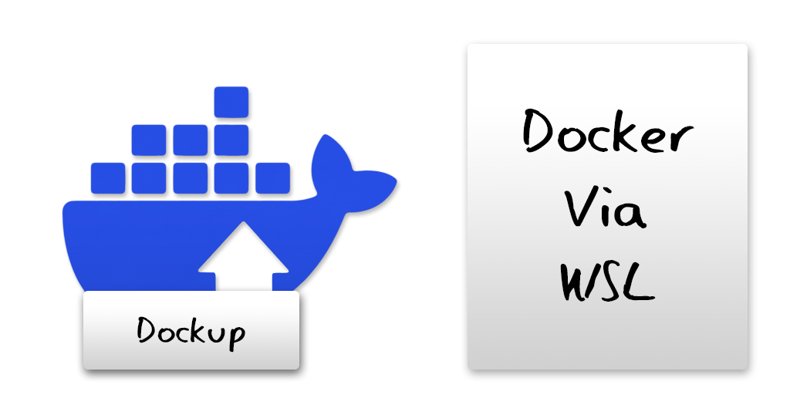
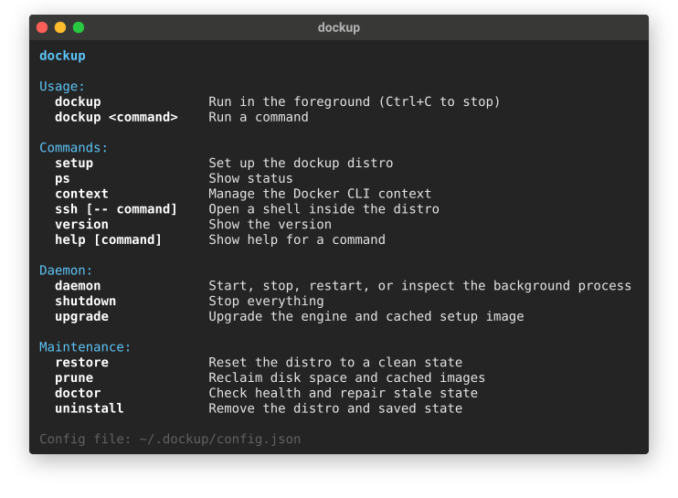
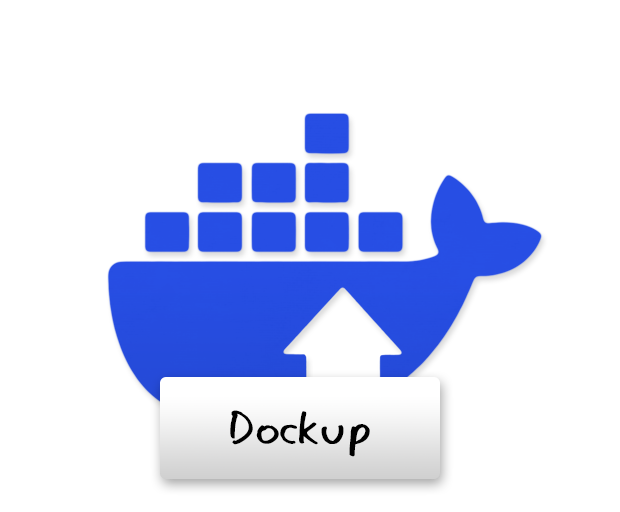

# Dockup

#### Docker without Docker Desktop.
Dockup uses `Windows Subsytem For Linux` *(WSL)*
You must have WSL installed in order for dockup to work! See the setup guide [**here.**](#installing)

*Full documentation: **<https://che3mz.github.io/dockup>***

## Installing

#### Skip to the dockup installation [here.](#installing-dockup)

### Installing WSL (required)

#### Prerequisites

* OS: 
  * **Version**: Windows 11 or 10
  * **Edition**: All editions are (currently) supported.
* Hardware:
  * **Hardware** Virtualization: Your CPU must support virtualization
    and it must be enabled in your BIOS/UEFI settings.
  * **Memory (RAM)**: 4 GB minimum (8 GB or more highly recommended).
  * **Storage**: At least 5–10 GB of free space for the core installation.

#### Quick Installation

Run the following commands and restart your PC post installation.

```
wsl --install
wsl --update
```

### Installing The Docker CLI (required)

An Installation of the docker CLI is required if you want to be able to use docker,
Dockup does NOT come with docker, it only bridges a docker backend to your docker CLI.

Mostly any Installation of the docker CLI should work;

For example:
- Via Scoop: `scoop install docker`
- Via Choco: `choco install docker`


### Installing Dockup

#### Via the Go package manager (Recommended)

```
go install github.com/CHE3MZ/dockup/cmd/dockup@latest
```

#### Manually from releases

* Download `dockup-windows-amd64.exe` (or `dockup-windows-arm64.exe`) from the [**latest release**](https://github.com/CHE3MZ/dockup/releases/latest).
* Put it in a directory that is on your **PATH**.

## Getting started

```powershell
dockup setup
dockup daemon start
docker run --rm hello-world
dockup daemon stop
```



## License

Dockup is licensed under the [**MIT License.**](LICENSE)

The Docker Project is also currently open source; see the [**component licenses.**](https://www.docker.com/legal/components-licenses/)

## Contributing

Any kind of support or contribution is welcome. See the [**contribution guidelines.**](.github/CONTRIBUTING.md)

